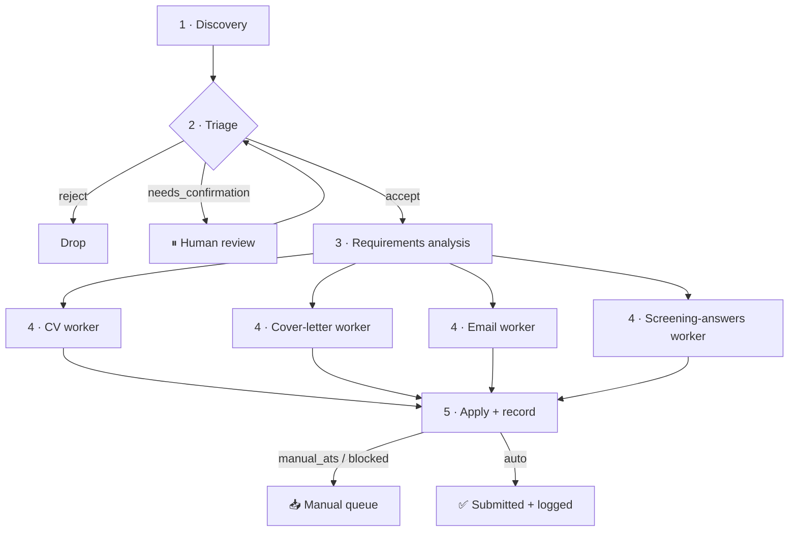

# 🤖 Design a Multi-Agent Job-Search System (LangGraph)

> **Role:** Act as my architecture partner. **Don't jump to code.** Help me converge on the
> agent topology, shared state, and persistence first — then we implement incrementally.

---

## 🎯 Goal

Build a multi-agent system that:

1. **Discovers** jobs
2. **Decides** whether to apply
3. **Figures out** what application materials each job needs
4. **Prepares** those materials — *truthfully*
5. **Submits** the application and **logs** the result

---

## 🧩 Context — what already exists (reuse, don't reinvent)

### Config lives in `src/config/`

| File | What it provides |
| --- | --- |
| `sites.yaml` | Scrape targets; `manual_ats` (skip auto-apply), `blocked` sites/URL patterns, `blocked_sso`, `base_urls`, and per-site `type: search \| static`. |
| `employers.yaml` | Workday tenants — a second discovery source via `/wday/cxs/{tenant}/{site_id}/jobs`. |
| `searches.example.yaml` | `queries` (tiered), `locations`, `location_accept` / `reject`, `exclude_titles`, `defaults`. |
| `work_profiles.yaml` | Candidate profiles + `match_rules` with the three outcomes below, plus strict anti-hallucination rules. |

> ⚠️ **Anti-hallucination rules in `work_profiles.yaml`**
> - A skill with **no record counts as missing**.
> - The English / TOEFL score **"is not remembered"** and must **not** be treated as B2/C1.
> - Never claim a `not_claimed` skill.

### Reference implementation: `../ApplyPilot`

A working **procedural** version already exists with stages:

```text
discover → enrich → score → tailor → cover → pdf → apply
```

It uses:

- A single **SQLite `jobs` table** as the conveyor belt between stages
- A **generate → `validator.py` loop**
- **Attempt caps** (`max_tailor_attempts`, etc.)
- **URL-based dedup**
- A **tiered feature-gate**

➡️ *Treat it as the reference implementation and port its lessons.*

---

## 🔁 The workflow to realize as agents

| # | Agent / Step | Responsibility | Notes |
| --- | --- | --- | --- |
| 1 | **Discovery** | Iterate URLs in `sites.yaml` (+ Workday from `employers.yaml`), scrape listings, apply `searches.yaml` filters (`locations`, `exclude_titles`). | Mostly deterministic (HTTP / API / CSS) with an LLM **smart-extract** fallback. |
| 2 | **Triage / decision** | Per job, apply `work_profiles.yaml` `match_rules` to choose **exactly one** profile and return `accept` / `reject` / `needs_confirmation`. | `needs_confirmation` **pauses for me**. |
| 3 | **Requirements analysis** | For each accepted job, decide which artifacts are needed. | tailored CV, cover letter, application email, short project/experience blurb, screening-question answers, … |
| 4 | **Document preparation** | One worker **per artifact type**, running in parallel. | Each bound by the anti-hallucination rules, each **validated** before acceptance. |
| 5 | **Apply + record** | Gather prepared artifacts, submit (browser / ATS), persist the full application record (status, timestamps, confidence, errors). | Respect `manual_ats` / `blocked` → those stop at *"prepared — apply by hand."* |

### Flow at a glance



---

## 🛑 Hard constraints

- **Truthfulness is non-negotiable:** generated docs may only use facts present in
  `work_profiles.yaml` / the CVs. **Preserve the generate → validate loop.**
- Respect `manual_ats`, `blocked`, `blocked_sso`, attempt caps, and URL dedup.
- The config YAMLs are the **source of truth** for domain logic — agents *read* them,
  they aren't hardcoded.

---

## 📦 Deliverable for this session

A proposed **LangGraph topology**:

- Nodes, edges, and the **shared state schema**
- Where **interrupts / human-in-the-loop** live
- Where **persistence / checkpointing** lives
- Which nodes are **deterministic tools** vs. **LLM agents**
- Plus the **trade-offs**

*Propose, then let me steer.*

---

## 🧭 The decisions I want us to make together

| # | Decision | Options | My lean |
| --- | --- | --- | --- |
| 1 | **Framework & pattern** | Confirm LangGraph, then: single **supervisor + workers**, **hierarchical teams** (discovery team + application team), or a **plain state machine** mirroring the linear pipeline. | Supervisor over a mostly-linear graph — steps are naturally sequential with one fan-out at step 4. |
| 2 | **Agent vs. deterministic tool** | Step 1 scraping and step 2's rubric are largely deterministic. LLM agents, or tool nodes with an LLM fallback? | Deterministic with LLM fallback — cheaper, more reliable, matches ApplyPilot. |
| 3 | **Shared state model** | One `JobState` object flowing through the graph vs. a job-id key into SQLite. How much lives in-graph vs. in the DB? | — |
| 4 | **Persistence & checkpointing** | Reuse the ApplyPilot SQLite `jobs` schema, use LangGraph's checkpointer, or both (DB for domain data, checkpointer for resumability). | — |
| 5 | **Human-in-the-loop** | Map step 2's `needs_confirmation` (and maybe *"about to submit"*) to LangGraph `interrupt`s. Which decision points pause for me? | — |
| 6 | **Fan-out at step 4** | Parallel artifact workers — how do step 3's decisions dispatch them, and how do results rejoin before step 5? | — |
| 7 | **Apply boundary** | Browser automation choice (chrome-devtools + cursor-ide-browser MCP available), and how `manual_ats` / `blocked` divert a job to a manual queue. | — |
| 8 | **Scope of v1** | Build the whole graph, or a vertical slice (one site → one profile → one artifact → logged) first? | Vertical slice. |

> ✅ **Next step:** If you confirm **(1)** the framework/pattern and **(8)** the v1 scope,
> I'll draft the concrete node/edge diagram and the `JobState` schema.

---

## ❓ Remaining open question

Can you point me at the course (or name the pattern it teaches — **supervisor**, **swarm**,
**hierarchical teams**)? That single detail will most shape the topology, and right now I'm
inferring it.
