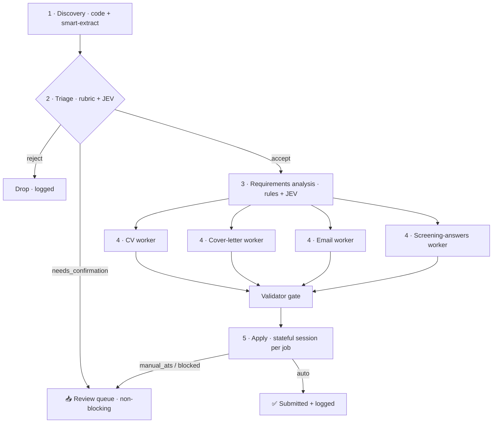

# 🤖 Design a Multi-Agent Job-Search System (LangGraph · local / Ollama)

> **Role:** Act as my architecture partner. **Don't jump to code.** Help me converge on the
> agent topology, shared state, and persistence first — then we implement incrementally.

---

## 🎯 Goal

Build a multi-agent system that runs **unattended in the background** and:

1. **Discovers** jobs
2. **Decides** whether to apply
3. **Figures out** what application materials each job needs
4. **Prepares** those materials — *truthfully*
5. **Submits** the application and **logs** the result

> 🏃 **Autonomy first:** the system should run **alone, start to finish, with as little human
> interaction as possible.** Human review is the exception (a queue), never a blocking gate.

---

## ⚙️ Runtime & models (local-first)

- **Everything runs locally on Ollama — no cloud tokens, no per-call cost.** On this hardware the
  budget is **CPU time + RAM**, not money, and the heavy work runs **overnight in batch**.
- Suggested split (sized for **CPU-only** inference):

| Job | Needs | Candidate local models (CPU-sized) |
| --- | --- | --- |
| **Typed decisions** (triage, requirements, fit-score, validation) | Fast, non-generative, returns probabilities | **JEV / System One** via `/v1/systemone`: `nimble` (9B) or `tev1` (4B) — one forward pass, cheap on CPU |
| Orchestration | Routing / tool-calling | Mostly **LangGraph code**; small `Qwen2.5 7B` only if an LLM call is needed |
| Document generation (CV, cover letter, email) | Fluent instruct writing | `Qwen2.5 7B` / `Llama 3.1 8B` (Q4) — **14–32B is impractical on CPU** |
| Validator | Catch hallucinated facts + judge quality | **Deterministic fact-check (must-pass)** + **JEV** threshold |
| Apply agent (browser) | Reason over page state | Text over **DOM / accessibility tree** — **vision is too heavy on CPU** |

> 💻 **Target hardware (confirmed).**
> - **iMac 27" 2019** — 6-core i5, 40 GB RAM, Radeon Pro 575X 4 GB. ⚠️ On **Intel macOS, Ollama runs
>   CPU-only** (no Metal; AMD GPUs aren't used), so the 4 GB GPU sits idle. 40 GB RAM easily holds
>   weights — **throughput is the limit** → keep generative models **≤ 7–8B (Q4)** and run overnight.
> - **Windows laptop** — i7, 32 GB RAM (CPU-only too). Optionally runs decisions/validation while the
>   iMac writes, if we want to split the load.
> - **Implication:** no GPU parallelism → the step-4 fan-out is **logical**; a semaphore serializes
>   generative calls behind one model. JEV decisions stay cheap, so lean on them.

> 🧪 **JEV (decision models), confirmed.** Jev is TypeSafe AI's *decision* paradigm — it **doesn't
> chat or write, it returns typed decisions + probabilities**. Ollama 0.35+ serves Jev-compatible
> models locally on `/v1/systemone`. Question types: `choice` (2–26 options), `noul` (→ P(true)),
> `score` (ordered levels → weighted average). Fast (~0.29 s/decision) and token-free. Perfect for
> **step 2 triage**, **step 3 requirements**, and the **fit-score** — anywhere we need a threshold,
> because the model *returns the probability we threshold on*. Caveat: local models are less
> calibrated than hosted Jev — validate thresholds on your own labelled examples.

> ⚖️ **Honest trade-off vs. the reference build:** the DEV post relied on **Claude Haiku** for
> fast, precise form-filling with page *screenshots*
> ([I Built an AI Agent to Apply to 1,000 Jobs](https://dev.to/picklepixel/i-built-an-ai-agent-to-apply-to-1000-jobs-while-i-kept-building-things-3j64)).
> Local models are slower and weaker at vision, so lean on **structured outputs** and feed the
> **DOM/accessibility snapshot as text** rather than images where possible.

---

## 🧠 Core design principle — stateful *per application*

The reference post's biggest lesson: **form-filling is a stateful session, not a sequence of
independent actions.** The agent must see the page, remember what it just filled, notice failures,
and adapt — so the apply brain is **one continuous conversation with persistent context per job**.

➡️ In LangGraph this becomes **one graph thread per job application**
(`thread_id = job url / id`), with the apply node carrying its own `messages` history. This gives
the stateful "brain" *and* crash-resume for free.

---

## 🧩 Context — what already exists (reuse, don't reinvent)

### Config lives in `src/config/`

| File | What it provides |
| --- | --- |
| `sites.yaml` | Scrape targets; `manual_ats` (skip auto-apply), `blocked` sites/URL patterns, `blocked_sso`, `base_urls`, and per-site `type: search \| static`. |
| `employers.yaml` | Workday tenants — a second discovery source via `/wday/cxs/{tenant}/{site_id}/jobs`. |
| `searches.example.yaml` | `queries` (tiered), `locations`, `location_accept` / `reject`, `exclude_titles`, `defaults`. |
| `work_profiles.yaml` | Candidate profiles + `match_rules` with the three outcomes below, plus strict anti-hallucination rules. |

> ⚠️ **Anti-hallucination rules in `work_profiles.yaml`**
> - A skill with **no record counts as missing**.
> - Missing secondary skills reduce fit; only a confirmed core-stack,
>   minimum-experience, or mandatory-constraint mismatch causes rejection.
> - The English / TOEFL score **"is not remembered"** and must **not** be treated as B2/C1.
> - Never claim a `not_claimed` skill.
>
> This mirrors the post's `resume_facts` lock: *the AI may reorganize and emphasize, but never invent.*

### Reference implementation: `../ApplyPilot`

A working **procedural** version already exists with stages:

```text
discover → enrich → score → tailor → cover → pdf → apply
```

It uses:

- A single **SQLite `jobs` table** as the conveyor belt between stages
- A **generate → `validator.py` loop**
- **Attempt caps** (`max_tailor_attempts`, etc.)
- **URL-based dedup**
- A **tiered feature-gate**

➡️ *Treat it as the reference implementation and port its lessons.*

---

## 🔁 The workflow to realize as agents

| # | Agent / Step | Responsibility | Deterministic vs. LLM |
| --- | --- | --- | --- |
| 1 | **Discovery** | Iterate URLs in `sites.yaml` (+ Workday from `employers.yaml`), scrape listings, apply `searches.yaml` filters (`locations`, `exclude_titles`). | **Plain code** (HTTP / API / CSS) + LLM **smart-extract** fallback. |
| 2 | **Triage / decision** | Per job, apply `work_profiles.yaml` `match_rules` to choose **exactly one** profile and return `accept` / `reject` / `needs_confirmation` (+ a fit-score). | **Rubric code first**, then **JEV** (`choice` for the outcome, `score` for fit) on the fuzzy calls. `needs_confirmation` → review queue (non-blocking). |
| 3 | **Requirements analysis** | For each accepted job, decide which artifacts are needed (tailored CV, cover letter, email, project blurb, screening answers…). | **3-layer:** (1) deterministic rules for hard signals → (2) **JEV decision model** (`noul`/`choice` per artifact, thresholded on P) for fuzzy free-text → (3) provisional, confirmed live by step 5. |
| 4 | **Document preparation** | **Default:** tailored CV → cover letter (CV-first). **Conditional:** apply-email, project blurb, and a **form-answering agent** for site-specific questions. | Generative LLM writers; each gated by the validator. **Logically parallel, serialized on CPU.** |
| 5 | **Apply + record** | Stateful session: build a **`Form` object** from the live page, fill it (artifacts + form-answering agent), submit, persist the record **and a retry link**. | DOM-text agent w/ persistent context. `manual_ats` / `blocked` / **failed attempts** → review queue (logged for the future frontend). |

### Flow at a glance



### 📝 The application `Form` object (shared)

Because screening questions vary per site, every form is normalized into a shared **`Form` object** —
a list of fields `{ id, label, type (text · textarea · select · radio · checkbox · file · email · number), options, required }`.
A reusable **form-answering agent** fills each field:

- **Structured fields** (select / boolean / "years of X" / "authorized in Spain?") → **JEV**
  (`choice` / `noul` / `score`) or a direct lookup from `work_profiles.yaml`.
- **Free-text fields** ("why this company?") → generative LLM, under the truthfulness rules.
- **Fields hitting `match_rules` `needs_confirmation`** (CEFR grade, Spain residence, English score)
  → **never guessed** → route the job to the review queue.

The same agent runs twice: pre-filling whatever is known at **step 4**, and finishing the rest
**live at step 5** against the real form.

---

## 🛑 Hard constraints

- **Truthfulness is non-negotiable:** generated docs may only use facts present in
  `work_profiles.yaml` / the CVs. **Preserve the generate → validate loop.**
- Respect `manual_ats`, `blocked`, `blocked_sso`, attempt caps, and URL dedup.
- The config YAMLs are the **source of truth** for domain logic — agents *read* them,
  they aren't hardcoded.
- **Unattended-safe:** because no human is watching, the guardrails matter more — attempt caps,
  rate limits, dedup, a `--dry-run` mode, and a kill switch.

---

## 🛡️ Anti-bot hardening (apply layer)

Layered, **local, no-token** — escalate only as InfoJobs pushes back:

1. **Persistent real session (primary).** Playwright drives a **dedicated Chrome profile** (its own
   `user_data_dir`) logged into a **dedicated InfoJobs account**, done by hand once and reused — or
   `connect_over_cdp` to a manually-launched Chrome. A real session + your **residential home IP** is
   the biggest win and sidesteps `blocked_sso` (the agent never touches credentials).
2. **Undetected driver (only if fingerprinted).** Swap in **`patchright`** (drop-in patched
   Playwright) or **`camoufox`** (anti-fingerprint Firefox). Both free/local.
3. **Human-like pacing.** Randomized delays, real viewport, one session at a time; the overnight
   batch + attempt caps already keep near-human rates.
4. **Reading side (separate from apply).** For 403-prone listing/description pages, read via
   **Jina Reader** (`r.jina.ai/<url>`) or **`JobSpy`** — never through the authenticated apply session.

> ⚠️ **Account hygiene:** use a **dedicated secondary account**, never your main — scripted logins
> carry a ban risk, and automated applying may conflict with a site's ToS.

---

## 📦 Deliverable for this session

A proposed **LangGraph topology**:

- Nodes, edges, and the **`JobState` schema**
- Where **persistence / checkpointing** lives (thread-per-job)
- Which nodes are **deterministic code** vs. **JEV decision models** vs. **generative LLM agents**
- How the **non-blocking review queue** replaces human interrupts
- Plus the **trade-offs**

*Propose, then let me steer.*

---

## ✅ Decisions locked in

| # | Decision | Choice |
| --- | --- | --- |
| 1 | **Framework & pattern** | **LangGraph with a supervisor** over a mostly-linear graph (one fan-out at step 4). |
| 2 | **Three execution tiers** | **deterministic code** (scrape / filter / dedup / hard rules) → **JEV decision models** (triage, requirements, fit, validation threshold) → **generative LLM** (doc writing + stateful apply). |
| 3 + 4 | **State & persistence** | Pydantic **`JobState`** per **thread-per-job** + LangGraph **checkpointer** (resume) **plus** a durable **`jobs` table** (dedup, dashboards, the future retry frontend). |
| 5 | **Autonomy** | **No blocking interrupts.** `needs_confirmation` / `manual_ats` / `blocked` / **failed attempts** → **review queue** in the DB (status + retry link); the pipeline continues. |
| 6 | **Step-4 fan-out** | **Default: tailored CV → cover letter** (CV-first). **Conditional:** apply-email, project blurb, **form-answering agent**. Logical parallel, **serialized on CPU**; results merge via a reducer, then the validator gate. |
| 7a | **Apply input** | **DOM / accessibility-tree text** (vision too heavy on CPU). |
| V | **Validator** | **Two-part gate:** deterministic **fact-check (must-pass)** against `work_profiles.yaml` **+ JEV** appropriateness threshold. **N failed tries → recorded failed attempt.** |
| R | **Runtime** | **Local, Ollama, CPU-only, overnight batch;** generative models ≤ 7–8B. |
| 7b | **Browser tool** | **Playwright** — headless, **persistent profile for logins**, `set_input_files` for the CV upload. Build a `page → a11y text → Form` serializer; chrome-devtools MCP is **dev/debug only**. |
| 8 | **v1 scope (MVP)** | **One configured, login-gated site:** discover → triage → **CV + cover letter** → fill form → **submit** → log. Persistent Playwright profile; **first login done by hand**, then reused. |
| 9 | **Model config** | **All model names read from `.env`** (`JEV_MODEL`, `WRITER_MODEL`, `APPLY_MODEL`, …) so configs swap without code. Starting defaults: `nimble`, `Qwen2.5 7B`. |
| 10 | **`needs_confirmation` routing** | Form fields asking for CEFR grade / Spain residence / English score are **never guessed** → straight to review queue. |
| S | **MVP site** | **InfoJobs** — main Spanish board, login-gated apply, ServiceNow + full-stack roles. |

## 🧭 Still to decide together

*All core architecture decisions are locked.* Remaining items are implementation-time, not architecture:

- **Anti-bot hardening** — approach locked (see the section above); escalate steps 2–3 only if InfoJobs pushes back.
- **The retry frontend** — out of v1 scope (the DB already records failed attempts + apply links).

> ✅ **Next step:** I propose the `JobState` + `Form` Pydantic schemas and the
> step 3 → fan-out → validator → step 5 subgraph (shared in chat). Once you're happy, I'll append
> them here and we build the InfoJobs vertical slice.

---

## ❓ Remaining open questions

1. **JEV calibration** — which decision model (`nimble` vs `tev1`) and what probability thresholds?
   Needs validation on a few labelled job postings before we trust it unattended.
2. **The course / pattern** — if the LangGraph course you liked teaches a specific flavor
   (**supervisor**, **swarm**, **hierarchical teams**), point me at it; it'll sharpen the topology.
