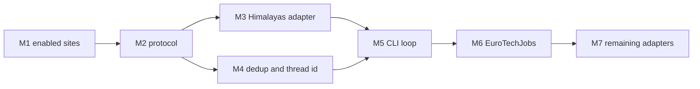

# 🛠️ Job Search Agent — multi-site build guide

> Work order for the planning session in [`Multisite agents prompt.md`](./Multisite%20agents%20prompt.md).
> v1 (LinkedIn Easy Apply) stays in [`v1_build_guide.md`](./v1_build_guide.md). This guide does not
> reopen triage, CV writing, or Easy Apply fill.
>
> **Status:** Parts M1–M5 are done. `run` walks each enabled site that has an
> adapter, skips EuroTechJobs until that adapter exists, and keeps LinkedIn on
> its current search. LinkedIn stays blocked, so a run does not open
> linkedin.com. The next work order is Part M6, EuroTechJobs.
>
> **How we use this doc:** each **Part** is one work order. You say *"build Part M3"*; I implement
> that part only. Tick the box when done.

Source list and “browse by hand” notes: [`emea_remote_job_sources.md`](./emea_remote_job_sources.md).
This guide is the automation plan for the **enabled** rows. It does not store credentials, bypass
CAPTCHA, or evade a login wall. A challenge stops that job and the run continues.

---

## 🎯 v2 scope (locked)

**Same command, more than LinkedIn:**

```bash
PYTHONPATH=src python -m jobsearchagent run --dry-run --limit 15 --max-jobs 80 --month 1
```

1. Read `enabled: true` sites from `src/config/sites.yaml` (skip `blocked` / `blocked_sso` / `manual_ats` hits).
2. Walk **site**, then query, then location, skipping axes the site does not support.
3. Discover, normalize to `JobState`, dedupe into SQLite.
4. Hand each new job to the existing G1 graph.

**In v2:** discovery across the enabled registry · shared triage · LinkedIn Easy Apply unchanged ·
every other accept recorded as `external` with `apply_url` on the review queue · one shared Chrome
profile · overnight batch keeps going when one site fails.

**Out of v2:** filling Workday, Greenhouse, Lever, Malt, or any other ATS · a second apply adapter ·
per-site daily submit caps · cloud scrape APIs · enabling Spain-only, LATAM, or bot-hostile boards.

**Autonomy:** login challenges, CAPTCHAs, empty listings, and HTTP 403/202 walls are logged. They
queue the current job when a URL is already known, then the loop moves to the next job or the next
site. They must not abort the batch.

---

## 🧱 Decisions (locked)

These answer the prompt’s design questions. Change them here before changing code.

| # | Question | Decision |
| --- | --- | --- |
| 1 | Search unit | **Site × query × location**, with skips. A `static` site, or `supports_query: false`, runs **once** (no query loop). `supports_location: false` runs **once** per query (no location loop). `--limit` is new jobs **per unit**. `--max-jobs` is new jobs for the **whole run** and stops discovery. |
| 2 | Adapter | One protocol. LinkedIn is adapter `linkedin`. Playwright for every v2 adapter (JS listings and the shared profile). No HTTP-only scraper in this phase. |
| 3 | Schema | The fields in [Schema](#schema-locked). `sites.yaml` is the only registry `run` reads. `sites_extended.yaml` is not an input. |
| 4 | CLI | Same flags for every site. Add `--site` and `--skip-site` (repeatable). `--geo-id`, `--easy-apply-only`, `--sort`, and `--posted-within` apply **only** to adapter `linkedin`. Other adapters ignore them. |
| 5 | `--month` / `--work-type` | Honor `posted_within` and `work_type` on the row: `native` or `url` builds the filter into the URL; `post_filter` drops rows after scrape; `unsupported` **skips that site** for this run and logs why. Missing a date on a `post_filter` site **keeps** the row (triage still judges location). |
| 6 | Apply | Auto-fill stays **LinkedIn Easy Apply** only. `easy_apply` is true only for that adapter. A second apply adapter is a later guide, not an M-part. |
| 7 | Browser | `profile: shared` → `CHROME_PROFILE_DIR`. `profile: dedicated` → `CHROME_PROFILE_DIR/<id>` (reserved; no enabled row uses it yet). First login on a site is manual. Reuse `LINKEDIN_ACTION_DELAY_MS` between page actions on every site. |
| 8 | Identity | `thread_id = "{id}:{source_job_id}"`, else `"{id}:{canonical listing url}"`. `easy_apply` means “this adapter can fill the form”, which in v2 is LinkedIn only. |
| 9 | Queries | One `searches.yaml` list. `query_style: phrase` (default) sends the phrase. `query_style: token` sends the first alphanumeric token (`ServiceNow developer` → `servicenow`). |
| 10 | Order | Interface around the **second** site (Himalayas, static, no login), then the CLI loop, then EuroTechJobs, then the rest **one adapter at a time**. |

### Loop

```text
for site in enabled(sites.yaml):          # skip blocked; skip unsupported --month
  units = search units for this site      # static → one; no location → drop that axis
  for unit in units:
    discover → normalize JobState(site=site.name, site id on the row)
    stop the unit at --limit
    stop discovery at --max-jobs
  on site error: log, continue
→ existing G1 per new job
    LinkedIn + easy_apply → dry-run fill / save / queue
    anything else → external + review_queue(apply_url)
```

Triage, profiles, SQLite, and the review UI stay shared. New work is discovery, config, dedup, and the CLI loop.

### Apply policy

| Job | v2 behaviour |
| --- | --- |
| LinkedIn Easy Apply | Unchanged: dry-run fills, saves, queues. Live submit only when `DRY_RUN=false`. |
| LinkedIn external ATS | Unchanged: `apply_status=external`, review link = employer URL. |
| Any other enabled site | `easy_apply=false`. Discovery stores `apply_url` (employer or board apply link). G1 triages. Accept and needs-confirmation both land on the review queue with that link. No form fill. |
| `manual_ats` / `blocked_sso` URL | Do not open the ATS. Queue the link. |

### Dedup

A job is already seen when any of these match:

1. `(site, source_job_id)` when the source id is non-empty.
2. Canonical listing URL.
3. Canonical `apply_url` when it is an absolute http(s) URL (same Greenhouse/Lever post on two boards).
4. Fingerprint: casefold `company`, `title`, and `location`, strip punctuation, collapse whitespace. Skip when company or title is still the unknown placeholder.

The first saved row wins. v2 does not merge descriptions.

### Failure isolation

| Failure | Effect |
| --- | --- |
| Site listing 403, empty, timeout, or “empty 202” | Log the site id and reason. Continue with the next site. |
| Login wall or CAPTCHA before any job URL | Log. Do not prompt in the middle of an overnight run. Continue. |
| One detail page fails | Skip that card. Continue the unit. |
| Graph/triage raises | Existing per-job failure path (`failed` + review). Next job runs. |

---

## 📋 Enabled set

The first development set in `sites.yaml` is `himalayas`, `eurotechjobs`, and `eurotechjobs-remote`. LinkedIn stays in the file and is listed under `blocked.sites`, so no command opens linkedin.com until that block is removed. The rows below are the backlog to turn on one adapter at a time. `enabled: false` rows stay in the file.

### On for the first adapters

`himalayas`, `eurotechjobs`, `eurotechjobs-remote`. LinkedIn is blocked for now.

### Why each row is in the registry

| id | Why it is here | Shape |
| --- | --- | --- |
| `linkedin` | Already the v1 path. Do not rename `name: "LinkedIn Jobs"`. | search, login, native month + work type, phrase queries, location |
| `remoteok` | Remote-only dev index. Static category, no account. | static, post-filter month |
| `wwr-fullstack` / `wwr-frontend` / `wwr-backend` | Remote programming categories, one `wwr` adapter. Smaller fit than Himalayas for these profiles. | static, post-filter month |
| `remotive-software` | Smaller curated remote software list. | static, post-filter month |
| `himalayas` | **Second site.** Norway-open remote volume for React, TypeScript, full-stack, and frontend. Country list is on the listing. | static, post-filter month |
| `justremote` | Remote developer category. | static, post-filter month |
| `working-nomads` | Remote development category. | static, post-filter month |
| `nodesk` | Remote index, low ceremony. | static, post-filter month |
| `dynamite-jobs` | Remote development category. | static, post-filter month |
| `jobgether` | Remote software with timezone / work-auth copy for triage. | static, post-filter month |
| `startup-jobs` | Search URL with `remote=true`. Phrase query, no location axis. | search, post-filter month |
| `eu-remote-jobs` | EU-timezone remote, hand-curated. | static, post-filter month |
| `eurotechjobs` | **First non-LinkedIn search board.** Path keyword, so `query_style: token`. | search, token, post-filter work type |
| `eurotechjobs-remote` | Same adapter, remote category, no query loop. | static |
| `landing-jobs` | EU tech search. Phrase query. Keep EU-remote rows; triage drops Spain-resident locks. | search, post-filter work type |
| `wttj` | Phrase + location (`Norway`, `Remote`, `Europe`). Real browser; empty 202 is a site failure, not a retry storm. | search, location, post-filter work type |
| `arbeitnow-remote` | Public EU/remote listings. | static |
| `finn-it` | Norway IT market (occupation `0.23`). Phrase query. | search, post-filter work type |
| `arc-dev` | Remote contract and freelance mix. | static |
| `freelancermap` | EMEA project board. Phrase query. | search, post-filter work type |
| `freelancermap-remote-eu` | Same adapter, EU-remote category, no query loop. | static |

Shared facts for every row except LinkedIn: `auth: none`, `profile: shared`, `posted_within: post_filter`, apply model = queue the link. Listing pages are category or search results; the adapter opens the detail (or the outbound apply URL) per card. Anti-bot stance: one polite browser, the shared profile, the action delay. No dedicated profile until a site proves the shared jar is a problem.

### Off until we edit `enabled`

| Rows | Why they stay off |
| --- | --- |
| InfoJobs, Tecnoempleo, Ticjob, JobFluent, Manfred, Michael Page ES, Remotive Spain | Spain-resident remote is the common case. Oslo/EMEA is the brief. |
| Talent.com Spain, Indeed Spain | Aggregators already called out as hostile. Also covered by `blocked` where noted. |
| Get on Board | Mostly LATAM. |
| Hacker News Jobs | Monthly thread, weak id stability versus scrape cost. |
| Malt | Marketplace login and an apply UI we will not fill in v2. |

Not in the registry, and not added in v2: Twago, Worksome, Uplink, Honeypot, YunoJuno. Glassdoor, Google, Accenture stay in `blocked`.

---

## Schema (locked)

Header of `sites.yaml` is authoritative. M1 checks it; do not invent parallel keys.

```yaml
sites:
  - id: wwr-fullstack                 # stable slug; thread_id prefix; adapter lookup
    name: "We Work Remotely Full Stack"  # display; LinkedIn name stays the F1 lookup key
    url: "https://weworkremotely.com/categories/remote-full-stack-programming-jobs"
    type: static                      # search | static
    enabled: true
    adapter: wwr                      # registry key, not a Python import path in YAML
    auth: none                        # none | login
    supports_query: false
    supports_location: false
    posted_within: post_filter        # native | post_filter | unsupported
    work_type: url                    # native | url | post_filter | unsupported
    profile: shared                   # shared | dedicated
    query_style: phrase               # phrase (default) | token — set token on eurotechjobs
```

`manual_ats`, `blocked`, `blocked_sso`, and `base_urls` stay as they are. A relative link is resolved with `base_urls[name]`.

---

## 🔢 Build order



**Sequence:** M1 → M2 → M3 → M4 → M5 → M6 → one M7 adapter when you name it.

LinkedIn `run` must still pass its current tests after every part. A part that only works when LinkedIn is disabled is not done.

---

### ☑ Part M1 — enabled-site loader · `CODE`

- **Goal:** `load_sites()` grows a typed reader for the rows `run` will walk. No browser.
- **Depends on:** F1.
- **Provides:** `enabled_sites() -> list[Site]`, `site_by_id(id) -> Site`.
- **Rules:**
  - Skip `enabled: false`.
  - Require `id`, `name`, `url`, `type`, `adapter`, `auth`, `supports_query`, `supports_location`, `posted_within`, `work_type`, `profile`.
  - `query_style` defaults to `phrase`.
  - `id` values are unique. `adapter` is a non-empty slug.
  - `type: static` must have `supports_query: false`.
  - LinkedIn’s `name` remains `"LinkedIn Jobs"`.
- **Done when:** a unit test loads the real `sites.yaml`; the enabled ids are `himalayas`, `eurotechjobs`, and `eurotechjobs-remote` (LinkedIn stays in the file and is blocked); a disabled Spain board is absent; a fixture missing `adapter` raises.

### ☑ Part M2 — discovery protocol · `CODE`

- **Goal:** one adapter interface. LinkedIn’s current scraper becomes adapter `linkedin` without changing its search behaviour.
- **Depends on:** M1, A1.
- **Module:** `discovery/registry.py` (name the map; keep `discovery/linkedin.py`).
- **Signature:**

  ```python
  class SearchFilters(TypedDict, total=False):
      month: int | None
      work_type: str | None          # remote | any | site-native code
      easy_apply: bool               # linkedin adapter only
      geo_id: str | None             # linkedin adapter only

  class SiteAdapter(Protocol):
      id: str
      def discover(
          self,
          page,
          site: Site,
          query: str | None,
          location: str | None,
          limit: int,
          filters: SearchFilters,
      ) -> list[JobState]: ...
  ```

- **Rules:**
  - Registry is `adapter slug → adapter`. Unknown slug raises at startup of a run, listing the site id.
  - Each returned state sets `site` to `site.name`, plus `url`, `title`, `company`, `location`, `raw_description`, `source_job_id` when the board has one, `apply_url`, `easy_apply`.
  - Non-LinkedIn adapters set `easy_apply=False`.
  - `query` / `location` are `None` when that axis was skipped.
  - The LinkedIn adapter keeps today’s URL builder (`linkedin_search_url`), Easy Apply detection, and external `apply_url`.
- **Done when:** the registry resolves `linkedin`; a fake adapter is invokable with `query=None` for a static site; LinkedIn unit tests still pass.

### ☑ Part M3 — Himalayas · `CODE`+`BROWSER`

- **Goal:** the second site, so the protocol is real. One adapter serves `himalayas`.
- **Depends on:** M2, F4c.
- **Behaviour:**
  1. Open `site.url` (no query, no location). Prefer the public jobs API when it returns the same fields a detail page would.
  2. Collect listings up to `limit` cards that are not `seen`. Keep a row when Norway or Spain is an allowed country, or the role is genuinely worldwide.
  3. Read title, company, location text, description, and the outbound apply URL.
  4. `source_job_id` is the stable Himalayas guid or slug when present, else empty and dedup falls through to the URL.
  5. `posted_within: post_filter`: drop listings whose visible date is older than `--month`. No date → keep.
  6. A blocked or empty category logs and returns `[]` (the CLI learns to continue in M5; this part just does not raise).
- **Done when:** a fixture payload yields one `JobState` with description and `apply_url`, `easy_apply` is false, and a second call with the same URL is `seen`. A live smoke is optional and manual.

### ☑ Part M4 — thread id and cross-site dedup · `CODE`

- **Goal:** checkpoints and SQLite survive more than one board.
- **Depends on:** F3, G1, M2.
- **Behaviour:**
  - `thread_id_for` returns `{site_id}:{source_job_id}` or `{site_id}:{canonical url}`.
  - Existing LinkedIn threads stay `linkedin:{id}` because the LinkedIn row’s `id` is `linkedin`. Do not rewrite old checkpoint ids.
  - `seen` / `upsert_job` implement the four dedup rules above. Add a nullable `content_fingerprint` column (idempotent migration) and an index. Store `site_id` if it is not already recoverable from `site` name (prefer a `site_id` column so display names can change).
  - Same apply URL on two enabled sites → the second discovery is a duplicate and is not triaged again.
- **Done when:** tests cover LinkedIn id stability, two board URLs with the same `apply_url`, and the same company+title+location with different listing URLs. `thread_id_for` on a WWR-shaped state does not start with a hardcoded `linkedin:` unless `site_id` is `linkedin`.

### ☑ Part M5 — `run` walks enabled sites · `CODE`+`BROWSER`

- **Goal:** the command in the scope box walks every enabled site the registry can build. Sites with no adapter yet are **skipped with a log line**, not a crash (so M5 can land before M7 finishes).
- **Depends on:** M1, M2, M3, M4, G2.
- **CLI:**
  - `--site ID` (repeatable) intersects the enabled set.
  - `--skip-site ID` (repeatable) removes ids.
  - `--limit` per unit, `--max-jobs` for the run, `--month N` as in the decisions table.
  - `--query` / `--tier` still select `searches.yaml` phrases. Token sites receive the first token inside the adapter or a single helper used by the loop — one implementation, not per adapter.
  - Default locations remain `JOB_LOCATIONS`. They are passed only when `supports_location` is true.
- **Session:** one Playwright context for the run (`profile: shared`). LinkedIn login behaviour stays. A site exception is caught at the site boundary.
- **Budget:** a static board is one unit, so `--limit 15` takes at most 15 new jobs from all three WWR rows combined only if you want that — **no**. Each enabled **row** is its own site unit. Three WWR categories are three units, 15 new jobs each, still under `--max-jobs`.
- **Done when:**
  - With only `linkedin` enabled (fixture or `--site linkedin`), `run --dry-run` matches today’s LinkedIn behaviour.
  - `--site wwr-fullstack --max-jobs 2` records at most two new jobs and does not open LinkedIn.
  - A raising adapter is logged and the next `--site` still runs.
  - `--month 1` on a `posted_within: unsupported` fixture site logs a skip and does not scrape it.

### ☐ Part M6 — EuroTechJobs · `CODE`+`BROWSER`

- **Goal:** the search-shaped template for later boards. Covers `eurotechjobs` and `eurotechjobs-remote`.
- **Depends on:** M5.
- **Behaviour:**
  - Search row: `query_style: token`, URL `.../keyword/{query_encoded}`, no location loop.
  - Remote row: open the static URL once.
  - Post-filter work type and month from the listing text.
  - Same `JobState` contract as M3. `easy_apply=false`.
- **Done when:** tokenising `ServiceNow developer` yields a `servicenow` path segment; a fixture search page returns one job; the static remote row does not iterate queries.

### ☐ Part M7 — remaining enabled adapters · `CODE`+`BROWSER`

Build **one adapter per request**, in any order. Each copies M3 (static) or M6 (search). Do not batch them in one change.

| Adapter | Rows | Template |
| --- | --- | --- |
| `remoteok` | `remoteok` | M3 |
| `remotive` | `remotive-software` only (Spain row stays disabled) | M3 |
| `himalayas` | `himalayas` | M3 |
| `justremote` | `justremote` | M3 |
| `working_nomads` | `working-nomads` | M3 |
| `nodesk` | `nodesk` | M3 |
| `dynamite` | `dynamite-jobs` | M3 |
| `jobgether` | `jobgether` | M3 |
| `eu_remote_jobs` | `eu-remote-jobs` | M3 |
| `startup_jobs` | `startup-jobs` | M6 without location; `query_style: phrase` |
| `landing_jobs` | `landing-jobs` | M6, phrase |
| `wttj` | `wttj` | M6, phrase + location |
| `arbeitnow` | `arbeitnow-remote` | M3 |
| `finn` | `finn-it` | M6, phrase, occupation fixed in the URL |
| `arc` | `arc-dev` | M3 |
| `freelancermap` | `freelancermap`, `freelancermap-remote-eu` | M6 + one static row |

- **Done when (each):** fixture → one `JobState`; second pass dedupes; failure returns or raises only inside the adapter so M5’s site boundary continues; LinkedIn tests still pass.

---

## Trade-offs

| Choice | What we gain | What we give up |
| --- | --- | --- |
| One shared Chrome profile | One overnight process, LinkedIn stays logged in, fewer windows. | A ban or cookie clear hits every site in that profile. Move a single row to `dedicated` later if that happens. |
| Playwright for static boards too | Same failure handling and JS pages as LinkedIn. | Heavier than a GET. Acceptable on a CPU overnight box; revisit only after an adapter is stable. |
| Post-filter `--month` on most boards | YAML stays honest where the site has no recency query param. | Extra detail opens for rows we then drop. Cap with `--limit` before the date check when the date is on the card; open details only for rows still inside the month. |
| Skip the site when recency is `unsupported` | `--month 1` never silently returns a two-year archive. | That site does nothing until its row learns a filter. |
| Phrase list everywhere, token only where the path requires it | `searches.yaml` stays the query source. | EuroTechJobs will not see `"full stack developer"` as a phrase. The token `full` is wrong — M6’s helper must map known phrases (`full stack developer` → `fullstack`, `ServiceNow developer` → `servicenow`) and fall back to the first token. Put that map next to the helper, not in each adapter. |
| Content fingerprint plus apply URL | The same Greenhouse post on WWR and Remotive is one review item. | Two different jobs that share a sloppy title at the same company can collapse. Require both company and title, and do not fingerprint unknowns. |
| Unknown adapter skips in M5 | The CLI can ship before 15 scrapers exist. | A typo in `adapter:` also skips. M1 startup of `run` must print skipped ids so a typo is visible. |
| No apply adapter beyond LinkedIn | The batch cannot submit on a board we do not understand. | Accepted remote jobs wait in the review queue for a person. |

---

## ✅ Definition of done (v2)

- `run --dry-run --limit 15 --max-jobs 80 --month 1` walks **enabled** sites that have an adapter, not only LinkedIn.
- `--site linkedin` preserves current Easy Apply dry-run behaviour.
- A Himalayas (or later) job is stored with `site`, survives dedup, receives JEV location and skills triage, and is queued with `apply_url` because it is not Easy Apply.
- A 403, empty listing, or login wall on one site is logged and the next site runs.
- Adding a board is a YAML row plus one adapter registered under its slug, not a fork of `cli.py`.

---

## 🔜 Tell me which part to build

Say **"build Part M1"**. I will implement that contract only, and I will not start M2 in the same change.
