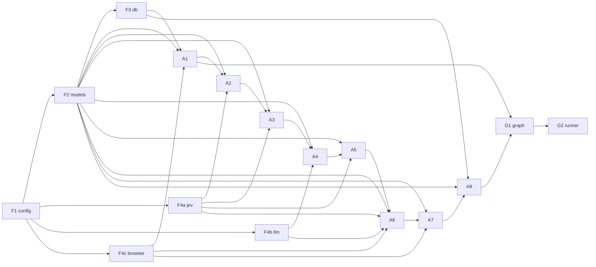

# 🛠️ Job Search Agent — v1 Build Guide (LinkedIn Easy Apply vertical slice)

> Implementation plan for the MVP agreed in [`architechture_prompt.md`](./architechture_prompt.md).
> Companion: [`jev_ollama_agent_guide.md`](./jev_ollama_agent_guide.md) for the decision models.
>
> **MVP override (October 2026):** LinkedIn replaces InfoJobs as the first production vertical
> slice. Where the architecture document still names InfoJobs as the MVP site, this guide is
> authoritative for v1 implementation. The agent searches LinkedIn and automatically submits only
> jobs that use **LinkedIn Easy Apply**. Jobs that open an external employer/ATS site are recorded
> in the review queue with their application link.
>
> **How we use this doc:** each **Part** below is a self-contained work order with a contract and
> acceptance criteria. You say *"build Part A3"*; I implement exactly that part against its contract.
> Tick the box when done.

---

## 🎯 v1 scope (locked)

**One site (LinkedIn), one happy path:** discover → triage (pick profile +
accept/reject/needs_confirmation) → tailor **CV** → write **cover letter** → validate →
**Playwright Easy Apply** (reuse a hand-login) → **record**.
`needs_confirmation` / `manual_ats` / `blocked` / failures → **review queue**, pipeline continues.

**In v1:** LinkedIn search + Easy Apply only · CV + cover letter only · JEV decisions · Ollama
generative ≤ 7–8B · SQLite + checkpointer · persistent Chrome profile · overnight/dry-run runner.

**Deferred (not v1):** Workday/`employers.yaml`, smart-extract, email/project-blurb artifacts,
parallel multi-artifact fan-out, external ATS automation, the retry frontend, multi-site.

**LinkedIn boundary:** use the normal authenticated web UI at a conservative rate. Security
challenges, CAPTCHA, expired sessions, unavailable Easy Apply, or any unexpected confirmation
screen stop that job and create a review item; v1 does not attempt to bypass them.

---

## 🧱 Tiers legend

`CODE` deterministic Python · `JEV` decision model (`/v1/systemone`) · `GEN` generative Ollama LLM ·
`BROWSER` Playwright.

---

## 📁 Package layout

Grouped **by domain/stage** like `ApplyPilot` (discovery/ · … · apply/), with flat client modules
(`llm.py` etc.) and **`graph.py` replacing `pipeline.py`** (LangGraph instead of a procedural runner):

```
src/jobsearchagent/
  __init__.py
  __main__.py          # `python -m jobsearchagent …`
  cli.py               # G2  CLI / batch runner  (ApplyPilot: cli.py)
  config.py            # F1  env + yaml loaders  (ApplyPilot: config.py)
  models.py            # F2  JobState, Form, Artifact, enums  (NEW — graph state)
  database.py          # F3  sqlite jobs + review_queue + checkpointer  (ApplyPilot: database.py)
  jev.py               # F4a decision client (see JEV guide)
  llm.py               # F4b generative Ollama client  (ApplyPilot: llm.py)
  browser.py           # F4c Playwright session manager  (ApplyPilot: apply/chrome.py)
  utils/               # F5  shared, pure helpers reused across nodes
    __init__.py
    text.py            # F5  query encode, clean/normalise job text, dedup keys
    profile.py         # F5  load + summarise a work profile (grounding + fact list)
    pdf.py             # F5  render CV / cover letter text → PDF for upload
  graph.py             # G1  LangGraph wiring  (replaces ApplyPilot pipeline.py)
  discovery/
    __init__.py
    linkedin.py        # A1  authenticated LinkedIn discovery (search + job details)
  triage/
    __init__.py
    triage.py          # A2  profile + outcome + fit   (JEV)
    requirements.py    # A3  required artifacts        (JEV/CODE)
  preparation/
    __init__.py
    cv.py              # A4  tailored CV               (GEN)
    cover_letter.py    # A4  cover letter              (GEN)
    validator.py       # A5  fact-check + JEV quality
  apply/
    __init__.py
    form.py            # A6  page → Form + answer fields
    submit.py          # A7  stateful submit           (BROWSER)
    record.py          # A8  persist + review queue
```

> Variant: to mirror ApplyPilot *exactly*, collapse `triage/` + `preparation/` into one `scoring/`
> package. I split them because decision (JEV) and writing (GEN) are different tiers.

---

## 🔢 Build order (dependency graph)



**Recommended sequence:** F1 → F2 → F3 → F4a/b/c → F5 → A1 → A2 → A3 → A4 → A5 → A6 → A7 → A8 → G1 → G2.

---

## ⚙️ Environment (`.env`)

```ini
OLLAMA_BASE_URL=http://localhost:11434
JEV_MODEL=nimble
WRITER_MODEL=qwen2.5:7b
APPLY_MODEL=qwen2.5:7b
DB_PATH=~/.jobsearchagent/jobsearch.db
CHROME_PROFILE_DIR=~/.jobsearchagent/chrome-profile
LINKEDIN_SEARCH_PAGE_LIMIT=2
LINKEDIN_DAILY_APPLY_LIMIT=10
LINKEDIN_ACTION_DELAY_MS=1200
JOB_LOCATIONS=["Norway", "Remote"]
MIN_FIT=1.0            # score threshold (calibrate later)
QUALITY_THRESHOLD=1.0  # JEV artifact-quality threshold
MAX_ARTIFACT_ATTEMPTS=3
MAX_BROWSER_ATTEMPTS=3
DRY_RUN=true           # never actually submits while true
```

---

# Phase 0 — Foundation

### ☑ Part F1 — `config.py` · `CODE`
- **Goal:** load `.env` + the existing `src/config/*.yaml` into typed accessors.
- **Depends on:** —
- **Provides:** `settings` (env), `load_sites()`, `load_searches()`,
  `load_work_profiles()`, `linkedin_search_url(query, location, easy_apply=True)`.
- **Config/assets:** `sites.yaml` (`LinkedIn Jobs` base/search URL),
  `searches.example.yaml`, `work_profiles.yaml`.
- **Signatures:**
  ```python
  class Settings(BaseModel):
      ollama_base_url: str
      jev_model: str
      writer_model: str
      apply_model: str
      db_path: Path
      chrome_profile_dir: Path
      linkedin_search_page_limit: int
      linkedin_daily_apply_limit: int
      linkedin_action_delay_ms: int
      job_locations: list[str]
      min_fit: float
      quality_threshold: float
      max_artifact_attempts: int
      max_browser_attempts: int
      dry_run: bool

  def get_settings() -> Settings: ...
  def load_work_profiles() -> dict: ...
  def linkedin_search_url(query: str, location: str, easy_apply: bool = True) -> str:
      """Fill query/location placeholders; add LinkedIn's Easy Apply filter when requested."""
  ```
- **Done when:** env + all three YAMLs load;
  `linkedin_search_url("ServiceNow developer", "Spain")` returns the encoded LinkedIn URL with
  recent-first and Easy Apply filters.

### ☑ Part F2 — `models.py` · `CODE`
- **Goal:** the shared `JobState` + nested models (the agreed schema).
- **Depends on:** —
- **Provides:** `JobState` (TypedDict w/ reducers), `Form`, `FormField`, `FieldAnswer`, `Artifact`, enums.
- **Schema (authoritative):**
  ```python
  Outcome        = Literal["accept","reject","needs_confirmation"]
  ArtifactType   = Literal["cv","cover_letter"]           # v1 subset
  ArtifactStatus = Literal["pending","validated","failed"]

  class FormField(BaseModel): id:str; label:str; type:Literal["text","textarea","select","radio","checkbox","file","email","number"]; options:list[str]=[]; required:bool=False
  class FieldAnswer(BaseModel): field_id:str; value:str|bool|list[str]|None=None; source:Literal["profile","jev","llm","deferred"]; confidence:float|None=None
  class Form(BaseModel): url:str; step_label:str|None=None; fields:list[FormField]=[]; answers:list[FieldAnswer]=[]
  class Artifact(BaseModel): type:ArtifactType; path:str|None=None; content:str|None=None; status:ArtifactStatus="pending"; attempts:int=0; fact_check_passed:bool=False; jev_score:float|None=None; error:str|None=None

  def merge_artifacts(l:dict,r:dict)->dict: return {**l,**r}

  class JobState(TypedDict, total=False):
      url:str; source_job_id:str; title:str; company:str; location:str
      site:str; raw_description:str; easy_apply:bool
      profile_id:str; outcome:Outcome; fit_score:float
      required_artifacts:list[ArtifactType]
      artifacts:Annotated[dict[str,Artifact], merge_artifacts]
      form:Form|None; messages:Annotated[list, add]
      apply_status:Literal["applied","failed","manual","external","skipped","dry_run_ready"]
      apply_url:str|None
      review_reason:str|None; attempts:int
  ```
- **Done when:** models import; a `JobState` round-trips through the reducer in a unit test.

### ☑ Part F3 — `database.py` · `CODE`
- **Goal:** SQLite system-of-record + review queue + LangGraph checkpointer.
- **Depends on:** F1, F2.
- **Provides:** `init_db()`, `upsert_job(state)`, `record_result(state)`,
  `add_to_review(url, reason, link)`, `seen(site, source_job_id, url)->bool`,
  `count_applied_today(site)->int`, `get_checkpointer()` (`SqliteSaver`).
- **Tables:** `jobs` (mirror of `JobState` terminal fields; unique LinkedIn
  `source_job_id`, canonical URL fallback) · `review_queue`
  (`url`, `reason`, `link`, `created_at`).
- **Done when:** `init_db()` is idempotent; two LinkedIn URL variants containing the same job ID
  dedupe to one job; daily submissions can be counted; checkpointer persists/reloads a thread.

### ☐ Part F4a — `jev.py` · `JEV`
- **Goal:** the decision client from the JEV guide (§4), `.env`-driven.
- **Provides:** `Jev.ask(state, questions)`, `.choice()`, `.noul()`, `.score()`.
- **Done when:** a live `ask` against `nimble` returns parsed answers (verify field names once).

### ☑ Part F4b — `llm.py` · `GEN`
- **Goal:** generative Ollama client for writers/apply reasoning.
- **Provides:** `chat(messages, model=None, format=None) -> str` (hits `/api/chat`); honors `WRITER_MODEL`/`APPLY_MODEL`.
- **Done when:** a prompt returns text from `qwen2.5:7b`; supports a JSON-format call.

### ☐ Part F4c — `browser.py` · `BROWSER`
- **Goal:** persistent Playwright session + a11y serializer.
- **Provides:** `session()` ctx (launch_persistent_context on `CHROME_PROFILE_DIR`), `page_to_form(page, url)->Form`, `a11y_text(page)->str`, `upload(page, selector, path)`.
- **Rules:** use one browser context and one active LinkedIn application at a time; respect
  `LINKEDIN_ACTION_DELAY_MS`; never automate login, CAPTCHA, or a security challenge.
- **Done when:** opens LinkedIn already logged in after a manual first login, reads a jobs search
  page, and `page_to_form` extracts fields from one Easy Apply modal step.

### ☑ Part F5 — `utils/` · `CODE`
- **Goal:** shared, **pure** helpers reused across nodes — side-effect-free and unit-testable.
- **Depends on:** F1, F2.
- **Modules & consumers:**
  - `text.py` — query encoding, job-text cleaning, dedup keys → used by **A1**.
  - `profile.py` — load/summarise a `work_profiles.yaml` profile + its fact list → used by **A2, A4, A5, A6**.
  - `pdf.py` — render tailored CV / cover letter → PDF for upload → used by **A4, A7** (ApplyPilot: `scoring/pdf.py`).
- **Rule:** `utils/` never imports nodes/graph (no upward deps); clients (`jev`/`llm`/`browser`) stay flat as *services*, not utils.
- **Done when:** each module imports clean, is tested in isolation, and carries no node/graph import.

---

# Phase 1 — Discovery & triage

### ☑ Part A1 — `discovery/linkedin.py` · `CODE`+`BROWSER`
- **Goal:** search authenticated LinkedIn for a query/location pair and return normalized candidate
  jobs with their full descriptions.
- **Depends on:** F1, F2, F3, F4c.
- **Reads:** `searches.example.yaml` queries/locations, `exclude_titles`, `location_accept`;
  `sites.yaml` entry `LinkedIn Jobs`.
- **Writes (per job):** `url,source_job_id,title,company,location,site,raw_description,easy_apply,apply_url`.
- **Behaviour:**
  1. Build the configured LinkedIn search URL; request recent-first results and use `f_AL=true`
     as a discovery optimization.
  2. Open it in the persistent authenticated browser and process at most
     `LINKEDIN_SEARCH_PAGE_LIMIT` result pages.
  3. Read each result card, open its detail panel, expand the description when needed, and extract
     the stable LinkedIn job ID plus canonical `/jobs/view/{id}/` URL.
  4. Verify Easy Apply from the job detail action itself. Do not trust the search filter alone.
  5. Dedupe by `(site, source_job_id)` with canonical URL fallback; then apply title and location
     filters before emitting a `JobState`.
  6. If the action opens an employer/ATS site, set `easy_apply=false`, preserve the external
     `apply_url`, and emit it so the graph can record it as `external` in the review queue.
- **Signature:**
  `def discover(query: str, location: str, limit: int = 20) -> list[JobState]: ...`
- **Done when:** a configured query returns at least one real LinkedIn job with job ID, company,
  location, and non-empty description; repeated runs produce no duplicate seeds; an external-apply
  job is classified without opening or filling the external ATS.

### ☑ Part A2 — `triage/triage.py` · `JEV`
- **Goal:** pick one profile + outcome + fit in one JEV call.
- **Depends on:** F4a, F1 (`work_profiles.yaml` `match_rules`).
- **Reads:** `raw_description,title` + profile summaries. **Writes:** `profile_id, outcome, fit_score, review_reason?`.
- **Behaviour:** `choice` over profiles (best match) → `choice` outcome (accept/reject/needs_confirmation) → `score` fit; `needs_confirmation` sets `review_reason`.
- **Matching policy:** core stack and explicit minimum experience must match;
  missing secondary skills lower fit but do not reject; reject only for a
  confirmed hard blocker.
- **Signature:** `def triage(state: JobState) -> dict: ...`
- **Done when:** a clearly-matching ServiceNow job → `accept` + a `servicenow-developer` profile; an off-target job → `reject`; a residence/English-gated one → `needs_confirmation`.

---

# Phase 2 — Preparation

### ☑ Part A3 — `triage/requirements.py` · `CODE`+`JEV`
- **Goal:** decide required artifacts. **v1:** always `["cv","cover_letter"]`; structure for future `noul` extras.
- **Depends on:** F4a.
- **Writes:** `required_artifacts`.
- **LinkedIn note:** both artifacts are prepared and validated. Easy Apply uploads the CV; the
  cover letter is attached or pasted only when the live form provides a corresponding field.
- **Done when:** returns `["cv","cover_letter"]` for an accepted Easy Apply job; code path exists
  to add `noul`-gated extras later.

### ☐ Part A4 — `preparation/cv.py` + `preparation/cover_letter.py` · `GEN`
- **Goal:** generate tailored **CV** (first), then **cover letter** (uses CV as context).
- **Depends on:** F4b, F2; profile facts from `work_profiles.yaml`, base CV from `src/assets`.
- **Reads:** `profile_id, raw_description`, `artifacts["cv"]` (for the letter). **Writes:** `artifacts["cv"|"cover_letter"].content`.
- **Hard rule:** only facts present in `work_profiles.yaml`/CV — no invention.
- **Signatures:** `def write_cv(state)->Artifact: ...` · `def write_cover_letter(state)->Artifact: ...`
- **Done when:** both produce content grounded only in profile facts (spot-checked against `not_claimed`).

### ☐ Part A5 — `preparation/validator.py` · `CODE`+`JEV`
- **Goal:** two-part gate per artifact; retry to cap, else mark `failed`.
- **Depends on:** F4a, F1.
- **Behaviour:** (a) **deterministic fact-check** vs `work_profiles.yaml` (reject unlisted/`not_claimed` skills, invented numbers) — must pass; (b) **JEV `score`** appropriateness ≥ `QUALITY_THRESHOLD`. Loop writer→validate up to `MAX_ARTIFACT_ATTEMPTS`.
- **Signature:** `def validate(artifact: Artifact, state: JobState) -> Artifact: ...` (sets `status`, `fact_check_passed`, `jev_score`).
- **Done when:** a planted hallucinated skill → `failed`; a clean artifact → `validated`; a required `failed` artifact routes the job to review.

---

# Phase 3 — Apply & record

### ☑ Part A6 — `apply/form.py` · `BROWSER`+`JEV`+`GEN`
- **Goal:** walk the live, multi-step LinkedIn Easy Apply modal and answer every supported field.
- **Depends on:** F4c, F4a, F4b.
- **Behaviour:**
  1. Click Easy Apply and serialize the current modal step to `Form`.
  2. Resolve profile-backed fields directly; use JEV for bounded structured choices and GEN for
     free text.
  3. Upload the validated CV. Use the cover letter only if a matching upload/text field exists.
  4. Validate required fields, click **Next** or **Review**, then re-serialize the next step.
  5. Keep one message/history thread for the whole modal; never treat steps as independent forms.
  6. **CEFR/residence/English-score**, unsupported fields, validation errors after the attempt cap,
     or any answer not grounded in the profile become `deferred` and set `review_reason`.
  7. Stop when the modal reaches its final review screen. Submission belongs only to A7.
- **Signature:** `def build_and_answer_form(page, state) -> Form: ...`
- **Done when:** a multi-step Easy Apply modal reaches Review with its known fields answered and CV
  uploaded; a planted unknown screening question routes to review and is never guessed.

### ☑ Part A7 — `apply/submit.py` · `BROWSER`
- **Goal:** submit the prepared Easy Apply modal using the hand-logged-in LinkedIn profile.
- **Depends on:** F4c, A6.
- **Behaviour:**
  - `easy_apply=false` → do not automate; set `apply_status="external"` and preserve `apply_url`.
  - Enforce `LINKEDIN_DAILY_APPLY_LIMIT` before opening the modal.
  - Resume the same browser/modal state produced by A6; do not restart the application.
  - `DRY_RUN=true` → stop at the final Review screen, set `apply_status="dry_run_ready"`, capture
    diagnostics, then close/discard the draft without clicking **Submit application**.
  - Live mode → click **Submit application** once; only set `applied` after LinkedIn displays its
    application confirmation. Store the canonical job/application link.
  - Missing Easy Apply, expired login, security challenge, CAPTCHA, unexpected modal, or capped
    browser error → stop and set `manual`/`failed` with a review reason.
- **Writes:** `apply_status, apply_url, messages`.
- **Done when:** dry run reaches Review without submission; a test double confirms only one submit
  click in live mode; external jobs and browser blockers are caught and queued rather than raised.

### ☑ Part A8 — `apply/record.py` · `CODE`
- **Goal:** persist terminal state; write failures/`needs_confirmation`/blocked/external applications
  to `review_queue` with a retry link.
- **Depends on:** F3.
- **Signature:** `def record(state: JobState) -> dict: ...`
- **Done when:** `jobs` row reflects final status; non-applied terminal states appear in `review_queue` with `url` + `link`.

---

# Phase 4 — Graph & runner

### ☐ Part G1 — `graph.py` · `CODE`
- **Goal:** wire the LangGraph; **thread-per-job**
  (`thread_id = "linkedin:{source_job_id}"`, canonical URL fallback), `SqliteSaver` checkpointer.
- **Depends on:** all A-parts.
- **Edges:** discovery result with `easy_apply=false`→record(external review) · Easy Apply→triage
  conditional → `reject`→record · `needs_confirmation`→record(review) ·
  `accept`→requirements → writers(cv→cover) → validator →
  (required failed→record(review)) → form → apply → record.
- **Done when:** `graph.invoke(seed, thread)` runs end-to-end on one job and is resumable after a kill.

### ☐ Part G2 — `cli.py` (+ `__main__.py`) · `CODE`
- **Goal:** CLI batch runner (ApplyPilot-style).
- **Commands:** `discover`, `run` (full slice over discovered jobs), `--dry-run`, `--limit`,
  `--query`, `--location`, `--easy-apply-only/--include-external`.
- **Done when:**
  `python -m jobsearchagent run --query "ServiceNow developer" --location "Spain" --dry-run`
  walks discover→…→record for each Easy Apply job and prints counts for discovered, duplicate,
  rejected, review, external, dry-run-ready, and applied.

---

## ✅ Definition of done (v1)

- `run --dry-run` processes real LinkedIn Easy Apply jobs end-to-end: triaged, CV + cover letter
  generated and validated, multi-step modal filled, CV uploaded, and stopped at Review before
  submission; results are stored in `jobs` / `review_queue`.
- External-apply LinkedIn jobs are recorded with their external URL and are never filled in v1.
- LinkedIn job IDs prevent duplicate processing across URL variants and search queries.
- Truthfulness holds: no artifact asserts a skill absent from `work_profiles.yaml`.
- `needs_confirmation` + `deferred` fields never auto-answered.
- Kill mid-run → re-run resumes from the checkpoint.
- Security challenges and expired login stop safely and create review items.
- Flip `DRY_RUN=false` on one hand-picked Easy Apply job → one real submitted application,
  confirmed by LinkedIn and recorded with a link.

---

## 🔜 Tell me which part to build

Say e.g. **"build Part F1"** (or a phase) and I'll implement it against the contract above, then we
move down the list. I'll keep each part small, tested against its *Done when*, before the next.
